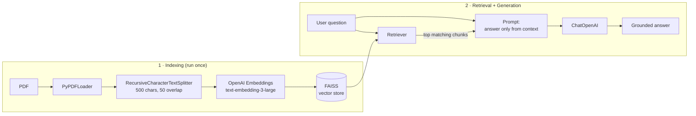

# RAG with OpenAI and LangChain

A **Retrieval-Augmented Generation (RAG)** pipeline that lets you ask questions about a long PDF and get answers **grounded in that document**. Without RAG, the LLM can only use what it learned during training.

The project loads a 176-page research thesis, splits it into chunks, embeds the chunks with OpenAI, stores them in a **FAISS** vector index, and uses a LangChain retrieval chain to answer questions from the most relevant passages.

---

## Why RAG?

LLMs don't know about your private or specialised documents, and they can make up answers when unsure. RAG fixes this in two steps:

1. **Retrieve**: find the passages in your document that are most relevant to the question.
2. **Generate**: give only those passages to the LLM and tell it to answer *based only on that context*.

This keeps answers specific to the source, lets you update knowledge without retraining a model, and works on documents far longer than you'd want to paste into a prompt.

---

## How it works



### Pipeline steps

| Step | Component | What it does |
|---|---|---|
| **1. Load** | `PyPDFLoader` | Reads the PDF into LangChain `Document`s, one per page, keeping metadata such as page number and title. |
| **2. Split** | `RecursiveCharacterTextSplitter` | Breaks pages into ~500-character chunks with a 50-character overlap, so sentences cut at a boundary still appear whole in one chunk. |
| **3. Embed** | `OpenAIEmbeddings` (`text-embedding-3-large`) | Turns each chunk into a numeric vector that captures its meaning. |
| **4. Store** | `FAISS` | Indexes the vectors for fast similarity search. |
| **5. Retrieve** | `storedb.as_retriever()` | Embeds the question and returns the chunks whose vectors are closest to it. |
| **6. Generate** | `create_stuff_documents_chain` + `ChatOpenAI` | "Stuffs" the retrieved chunks into the prompt as `{context}` and asks the LLM to answer using only that context. |
| **7. Chain** | `create_retrieval_chain` | Connects retrieval and generation into a single `.invoke()` call. |

### The grounding prompt

```text
Answer the following question based only on the provided context:
<context>
{context}
</context>

Question: {input}
```

The instruction *"based only on the provided context"* keeps the model tied to the document instead of its general knowledge.

---

## Example

**Source document:** *Machine Learning and Geostatistical Approaches for Discovery of Weather and Climate Events Related to El Niño Phenomena*, a 176-page thesis by Sachi Perera (Chapman University, 2024).

**Question:**
> Clearly explain the Palmer Drought Severity Index, outlining the important facts

**Answer (excerpt):**
> The **Palmer Drought Severity Index (PDSI)** is a widely used index for assessing and quantifying **regional drought conditions** using meteorological data.
> - Developed by climatologist **Wayne Palmer** in the early 1960s
> - Considers **temperature**, **precipitation** and **soil moisture**
> - **Positive values** → wetter than average; **negative values** → drought
> - Values between **−1 and −2** indicate **moderate drought**
> - Used in agriculture, water-resource management and planning

The answer comes from passages retrieved from the thesis, not from the model's general training data.

The notebook also shows the building blocks separately: embedding a single sentence with `embed_query`, calling the LLM directly, and building a basic `prompt | llm` chain with `ChatPromptTemplate`.

---

## Project structure

```
.
├── llm2.ipynb                  # Full RAG pipeline, step by step
├── machine learning.pdf        # Source document (El Niño / climate ML thesis)
├── Langchain.code-workspace    # VS Code workspace settings
├── .gitignore                  # Keeps .env (API key) and env folders out of Git
└── README.md
```

---

## Getting started

### 1. Clone the repository
```bash
git clone https://github.com/Paulokw/RAG-with-OpenAI.git
cd RAG-with-OpenAI
```

### 2. Create and activate a virtual environment
```bash
python -m venv venv
# Windows
venv\Scripts\activate
# macOS / Linux
source venv/bin/activate
```

### 3. Install dependencies
```bash
pip install langchain langchain-core langchain-community langchain-classic langchain-openai langchain-text-splitters faiss-cpu pypdf python-dotenv jupyter
```

### 4. Add your OpenAI API key
Create a `.env` file in the project root:
```env
OPENAI_API_KEY=your_openai_api_key
```
Get a key at <https://platform.openai.com/api-keys>. `.env` is listed in `.gitignore`, so the key is never committed.

> **Cost note:** embedding the full 176-page PDF with `text-embedding-3-large` makes paid API calls. It's a small cost, but switching to `text-embedding-3-small` makes it even cheaper.

### 5. Run the notebook
```bash
jupyter notebook llm2.ipynb
```
Run the cells from top to bottom, then ask your own questions:
```python
response = retrieval_chain.invoke({"input": "What machine learning methods are used to study El Niño?"})
print(response["answer"])
```

### Use your own document
Replace the file name in the first cell:
```python
loader = PyPDFLoader("your_document.pdf")
```

---

## Tech stack

- [LangChain](https://python.langchain.com/): document loaders, text splitters, prompts and chains
- [OpenAI](https://platform.openai.com/): `text-embedding-3-large` for embeddings, a GPT chat model for answers
- [FAISS](https://github.com/facebookresearch/faiss): vector similarity search
- [PyPDF](https://pypi.org/project/pypdf/): PDF parsing
- [python-dotenv](https://pypi.org/project/python-dotenv/): loads the API key from `.env`

---

## Possible extensions

- **Save the FAISS index** (`storedb.save_local(...)`) so the PDF isn't re-embedded on every run
- **Return sources:** show the page numbers of the retrieved chunks next to each answer
- **Tune retrieval:** try different chunk sizes, `k` (number of chunks), or MMR search for more varied results
- **Support several documents:** load a whole folder of PDFs into one index
- **Add a chat UI** with Streamlit or Gradio
- **Evaluate answers** with a small set of question–answer pairs

---

## Acknowledgements

The example document is *Machine Learning and Geostatistical Approaches for Discovery of Weather and Climate Events Related to El Niño Phenomena* by Sachi Perera, made available through Chapman University Digital Commons. All rights to the document belong to its author and publisher; it is used here only to demonstrate the pipeline.
